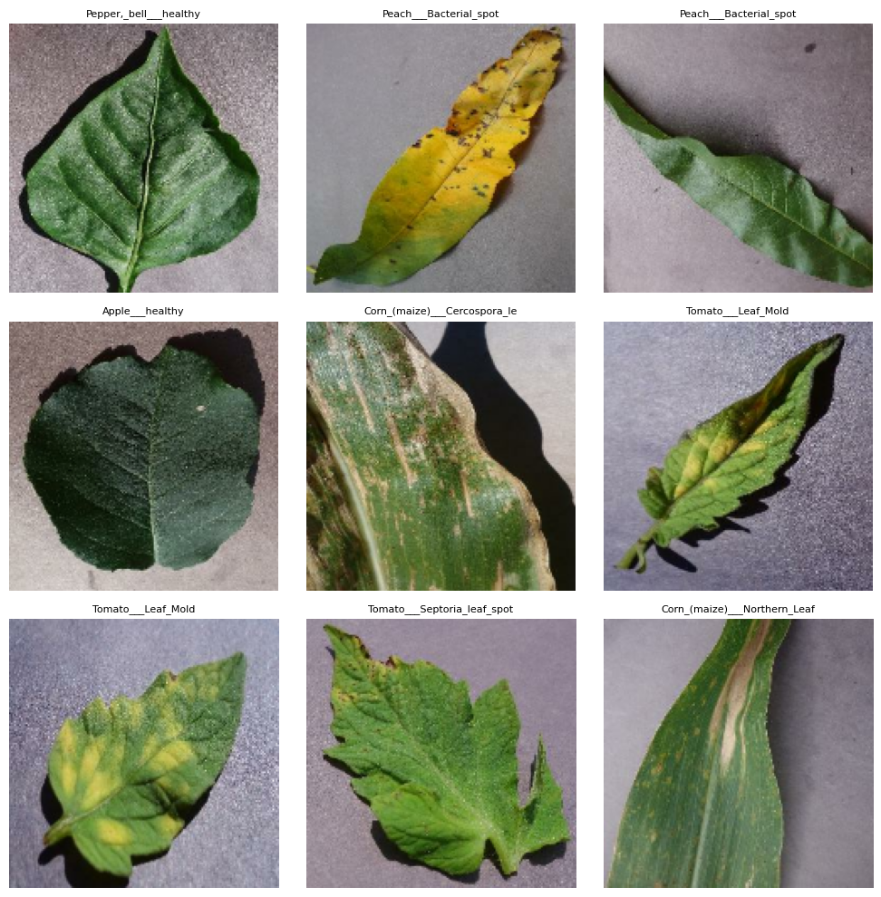
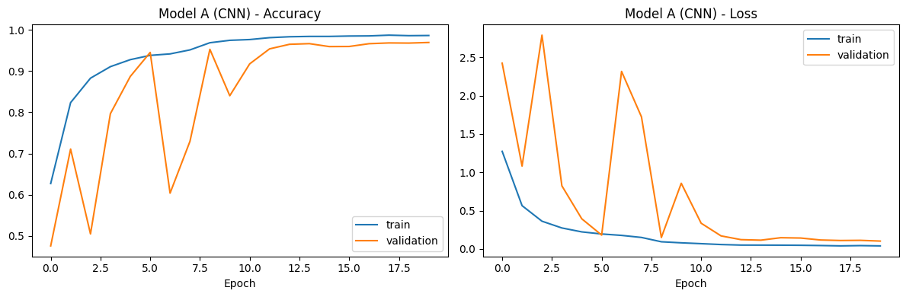
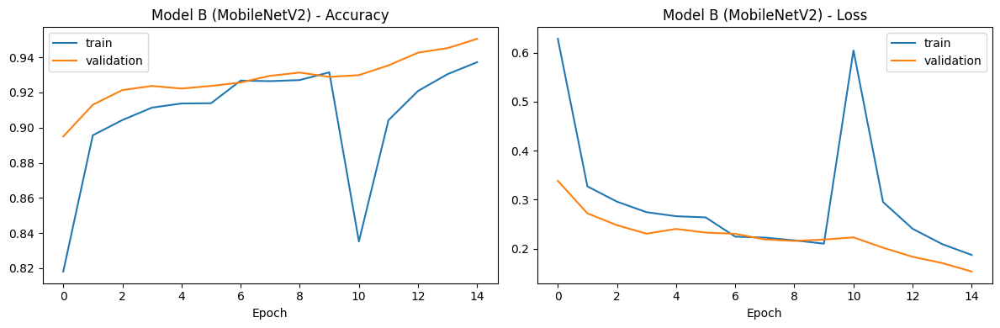
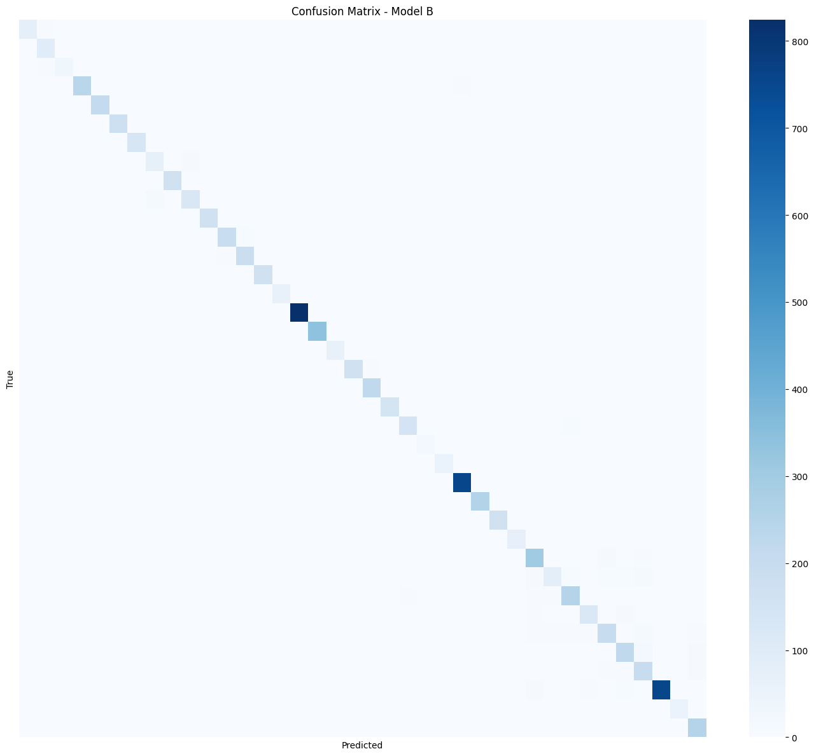
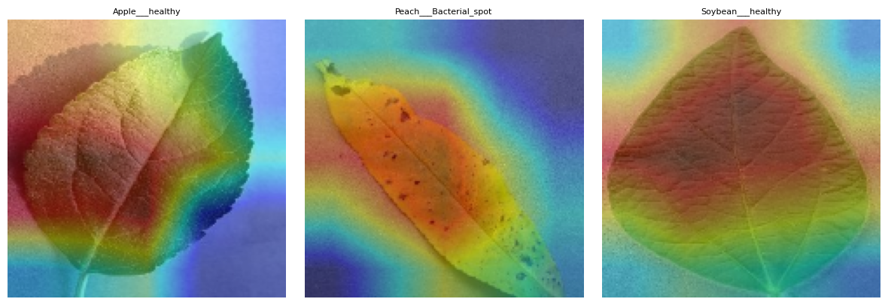

# Plant Leaf Disease Classification with CNN [](https://colab.research.google.com/github/ilhanumut01/DeeplearningProject/blob/main/plant_disease_cnn_colab.ipynb)


A deep learning course project that classifies plant leaf photos into **38 healthy / diseased classes** using convolutional neural networks. Two approaches are trained and compared on the same data: a **custom CNN built from scratch** and **transfer learning with MobileNetV2**.

| Custom CNN | MobileNetV2 (transfer learning) |
|:---:|:---:|
| **97.0%** test accuracy | 95.0% test accuracy |

## Table of Contents
- [Dataset](#dataset)
- [Models](#models)
- [Training Setup](#training-setup)
- [Results](#results)
- [Grad-CAM](#grad-cam)
- [Limitations](#limitations)
- [How to Run](#how-to-run)
- [Repository Structure](#repository-structure)

## Dataset

[PlantVillage](https://www.kaggle.com/datasets/abdallahalidev/plantvillage-dataset) (Kaggle), color images only.

- **54,305 images**, **38 classes**, 14 plant species (apple, corn, grape, potato, tomato, ...)
- Split: **70% train / 15% validation / 15% test** (the test set has 8,161 images)
- Images resized to 160×160
- The dataset is downloaded automatically in the notebook with `kagglehub`, no manual download needed



## Models

**Model A: Custom CNN (from scratch)**
- 4 blocks of Conv2D + BatchNorm + MaxPooling (32 → 64 → 128 → 256 filters)
- GlobalAveragePooling → Dense(256) → Dropout(0.5) → Softmax

**Model B: MobileNetV2 (transfer learning)**
- ImageNet-pretrained MobileNetV2 as the feature extractor
- Stage 1: frozen base, only the new classification head is trained
- Stage 2: fine-tuning of the last 30 layers with a very small learning rate

## Training Setup

| | Model A | Model B |
|---|---|---|
| Optimizer | Adam, lr = 1e-3 | Adam, lr = 1e-3 (stage 1), 1e-5 (stage 2) |
| Epochs | up to 20 | 10 (frozen) + 5 (fine-tuning) |
| Loss | Sparse categorical crossentropy | Sparse categorical crossentropy |

Shared settings: batch size 32, seed 42, `EarlyStopping` (patience 4, best weights restored), `ReduceLROnPlateau` (factor 0.3, patience 2).
Data augmentation: random flip, rotation, zoom and brightness change.




Both models converge without strong overfitting. Model A's validation accuracy fluctuated in the first epochs and then stabilized; Model B was more stable, and fine-tuning raised its validation accuracy from about 93% to 95%.

## Results

Evaluated on the held-out test set (8,161 images):

| Model | Test accuracy | Macro F1 | Weighted F1 |
|---|---|---|---|
| Custom CNN | **0.970** | **0.957** | **0.969** |
| MobileNetV2 | 0.950 | 0.938 | 0.950 |

Observations:
- The custom CNN outperformed transfer learning, the opposite of what was initially expected. Possible reasons (hypotheses, not tested): the dataset is clean and simple, so a small CNN is enough, and the MobileNetV2 fine-tuning was short (5 epochs) with validation accuracy still rising.
- For MobileNetV2, the weakest classes are visually similar tomato diseases: *Tomato Early blight* (F1 0.70), *Target spot* (0.82) and *Septoria leaf spot* (0.85).
- For the custom CNN, the lowest-scoring class is *Potato healthy* (F1 0.59), but it has only 23 test images, so that number is not very reliable.

Confusion matrix (MobileNetV2):



## Grad-CAM

Grad-CAM heatmaps (MobileNetV2) show which image regions the model uses for its prediction. The model mostly focuses on the leaf body; it does not precisely localize individual disease spots.



## Limitations

- PlantVillage images are taken in a controlled lab setting (single leaf, plain background). Accuracy on real field photos is likely lower.
- The data is split at image level. PlantVillage contains multiple photos of the same leaves, so the reported accuracy may be optimistic compared to truly unseen plants.
- Only one run per model was evaluated, so differences between runs were not measured.

## How to Run

**Google Colab (recommended)**
1. Open [Google Colab](https://colab.research.google.com) and upload `plant_disease_cnn_colab.ipynb` (`File > Upload notebook`).
2. Set `Runtime > Change runtime type > T4 GPU`.
3. Run all cells (`Runtime > Run all`). The dataset is downloaded automatically; training takes roughly 20-40 minutes.

**Local**
```bash
pip install -r requirements.txt
jupyter notebook plant_disease_cnn_colab.ipynb
```
Training on CPU is very slow; a GPU is strongly recommended. On the first run the notebook downloads the dataset to the local `kagglehub` cache (several GB).

## Repository Structure

```
.
├── plant_disease_cnn_colab.ipynb   # full pipeline: data, training, evaluation, Grad-CAM
├── requirements.txt
├── images/                         # figures used in this README
└── README.md
```

## Future Work

- Test on real field images and with a plant-level (leaf-level) data split
- Longer fine-tuning and larger input resolution for MobileNetV2
- Deploy as a mobile app for on-site diagnosis
